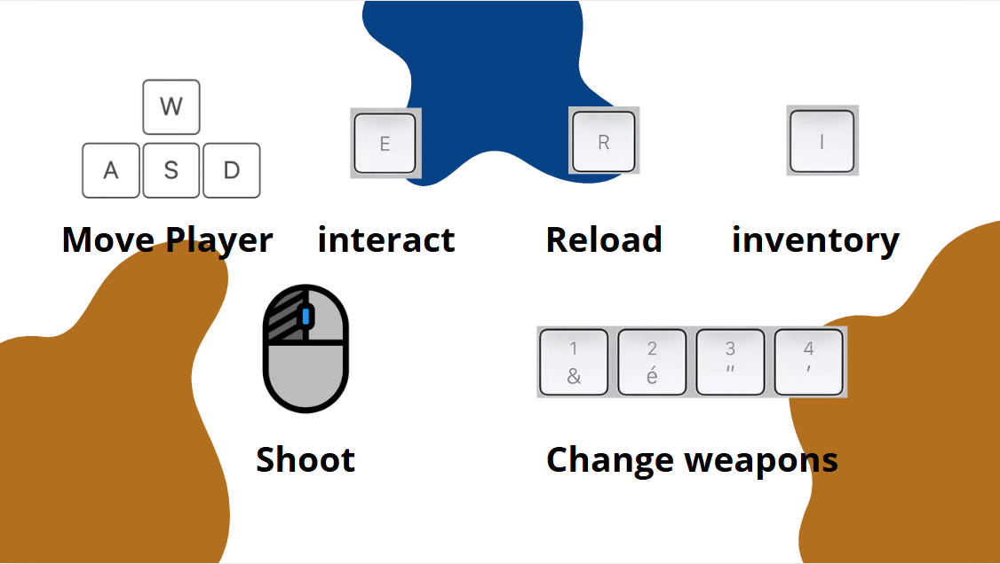

  

<h1 align="center">Cajaz Royale</h1>

  Top-down 2D online multiplayer battle royale, built with <b>Unity</b> and <b>C#</b>.

  
  
  

---

## Overview

Players spawn on a city map that is **randomly generated for every match**. They collect weapons and items, fight each other, and survive a **shrinking zone** until only one player is left standing.

Team project completed at **EPITA** (2024-2025).

## Features

- **Online multiplayer** with Photon PUN 2: lobby, rooms, synchronized movement, shooting, health and animations.
- **Solo mode** against AI-controlled enemies.
- **Procedural map generation**: roads (*random walker* algorithm), buildings, props and vegetation placed with noise.
- **Battle zone** that shrinks and damages players caught outside.
- **Enemy AI**: state machine (patrol, chase, attack) and A* pathfinding.
- **Combat**: several weapons, reloading, explosions, health and respawn.
- **Inventory** and items to pick up from chests or the ground.
- **Full menu system**: main menu, settings (audio, display), pause, end of game, credits.
- **URP rendering** with 2D lighting, shadows and a Cinemachine camera.

## Controls

  

| Key | Action |
|---|---|
| `W` `A` `S` `D` | Move |
| Left click | Shoot |
| `R` | Reload |
| `E` | Interact / pick up |
| `I` | Open inventory |
| `1` to `4` | Switch weapon |

## Code structure

Game scripts are located in [`Assets/scripts/`](Assets/scripts):

| Folder / file | Role |
|---|---|
| `MapGen/` | Procedural generation: roads (`WalkerGenerator`), buildings (`CityBuider`, `Batiment7`), noise (`Noise`) |
| `AI/` | Enemy AI: state machine (`StateManager`, `PatrolState`, `ChaseState`, `AttackState`) and spawning (`Spawner`) |
| `Inventory/` | Inventory, items and their UI |
| `Menus/` | Main menu, lobby, settings, pause, end of game, credits |
| `Game.cs`, `GameSolo.cs` | Match flow in multiplayer and solo modes |
| `RoomManager.cs`, `PlayerSetup.cs` | Photon connection, room creation and player spawning |
| `DamageCircle.cs` | Shrinking zone |
| `Health.cs`, `Bullet.cs`, `gun.cs` | Health, projectiles and weapons |

The main scenes are in [`Assets/Scenes/`](Assets/Scenes): `MainMenu`, `SampleScene` (multiplayer match) and `Solo`.

## Running the project

1. Create a new **Unity 2D (URP)** project.
2. Replace its `Assets/` folder with the one from this repository.
3. In `Assets/Photon/PhotonUnityNetworking/Resources/PhotonServerSettings`, enter your own **Photon PUN App ID**.
4. Open the `Assets/Scenes/MainMenu.unity` scene and press Play.

## Team

- **Charles Roussel**: networking and multiplayer, procedural generation, battle zone, solo mode, integration
- **Jad Bendali**: graphic assets, animations, tiles and inventory
- **Abdoul-Hakim Mahamat Alhabo**: menus and UI
- **Muhammad-Zuhayr Shaikh**: enemy AI
